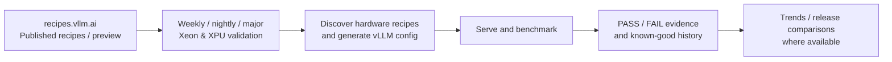

# vLLM Recipes Validation

The primary purpose of this project is to **continuously validate the model-serving recipes published at [recipes.vllm.ai](https://recipes.vllm.ai/)** against real Intel Xeon CPU and Intel XPU hardware. It checks whether each published hardware-specific recipe can generate a usable vLLM configuration, start successfully, and complete a serving benchmark with an official vLLM Docker image.

Weekly, nightly, and major-version runs track recipe compatibility across vLLM updates, record failures and performance evidence, and preserve the latest known-good configurations.

See the **[detailed validation workflow guide](docs/validation-workflows.md)** for execution, manual runs, benchmarking, artifacts, and publication.

## How validation works

## Workflows

| Platform | Workflow | Schedule / use | Runtime |
| --- | --- | --- | --- |
| Xeon 6 | [Weekly](.github/workflows/weekly-xeon6.yml) | Sunday 01:00 Pacific | CPU `latest-x86_64` |
| Xeon | [Nightly](.github/workflows/nightly-xeon6.yml) | Daily 08:00 UTC | CPU `nightly` |
| Xeon 6 | [Major version](.github/workflows/major-version-xeon6.yml) | Manual, pinned release | Pinned CPU release image |
| XPU B70 | [Weekly](.github/workflows/weekly-xpu.yml) | Sunday 02:00 Pacific | XPU `latest` |
| Xeon 6 | [Weekly report](.github/workflows/weekly-report.yml) / [major report](.github/workflows/major-version-report.yml) | After corresponding validation or manual | Comparison reporting |

**Roadmap:** Extend the existing major-version qualification and release-comparison pattern to **XPU**, and potentially add **XPU nightly** validation. These workflows are *planned*, not currently implemented. The shared validation path is intended to support them without platform-specific duplication.

The Xeon weekly and XPU weekly schedules are timezone-aware (PST/PDT). Xeon nightly is fixed at 08:00 UTC, so its Pacific local time shifts with daylight saving time.

## Recipe and runtime sources

By default, validation uses the published [vLLM Recipes catalog](https://recipes.vllm.ai/). To test a proposed Recipes change before merge, set `recipe_api_base` to its preview deployment. To test serving-tool changes independently, set `recipe_tools_repo` and `recipe_tools_ref` to the desired Git repository and revision.

Manual workflow inputs also support an individual `model`, a `vllm_image`, and optional nonsecret `vllm_env_vars`. See the [workflow guide](docs/validation-workflows.md) for examples.

## View results in GitHub Actions

1. Open **Actions**, choose a validation workflow (for example, **Weekly Intel XPU Recipe Validation**), then select a run.
2. Open the run's **Summary** to review discovered, attempted, PASS, FAIL, and SKIP counts and the per-model results table. Xeon workflows also show platform and benchmark details.
3. For a failure, expand the validation job logs; download the run's artifact under **Artifacts** to inspect `weekly-summary.html` / `weekly-summary.json` and `models/<org>__<model>/server.log`, `benchmark.log`, `result.json`, and generated `config.yml`.
4. For Xeon weekly or major-version **comparisons**, open the corresponding **Weekly Xeon 6 Comparison Report** or **Major Version Xeon 6 Comparison Report** workflow run. A green workflow check alone does not imply every model passed; inspect the per-model summary.

See [the detailed guide](docs/validation-workflows.md#8-reading-github-actions-results) for result interpretation and publication details.

## Results and scope

- Each model runs in an official Docker container with `serve_with_recipe.sh`, generated `config.yml` / `env.sh`, vLLM server, and `vllm bench serve`.
- Default text-generation smoke test: **128 input / 128 output tokens**, concurrency **1**; **20 prompts** weekly, **5** Xeon nightly, **100** Xeon major. Specialty tasks use `config/model_overrides.json`.
- Results include per-model status, server/benchmark logs, timing and throughput, image/tool provenance, and history. Only **PASS** updates the last known-good recipe; FAIL/SKIP retains the previous known-good bundle.
- Publication targets include `validated-xeon6`, `validated-xeon6-nightly`, `validated-arc_pro_b70`, and version-specific Xeon branches. Xeon comparison reports are separate workflows.
- XPU weekly and Xeon major allow extended startup time for network-storage checkpoints.

A smoke-test PASS is not proof of full model accuracy, multimodal correctness, or production SLO compliance. For detailed behavior and commands, see the [workflow guide](docs/validation-workflows.md).
