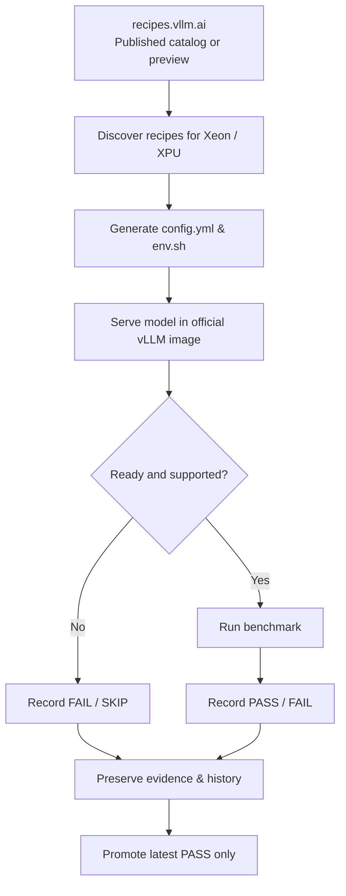

# Validation workflows — detailed guide

The purpose of this harness is to validate the hardware-specific model-serving configurations published at **[recipes.vllm.ai](https://recipes.vllm.ai/)**, not merely to benchmark arbitrary vLLM models. Each run discovers Recipes entries, deploys their generated configuration on the selected Intel platform, and records serving success, performance, and reproducible evidence.

This guide provides the operational details behind the [main README](../README.md). Xeon and XPU workflows share `scripts/weekly.sh`, model discovery, the per-model Docker runner, and publication. XPU **major-version** and **nightly** workflows are planned extensions.

## 1. Shared execution flow



The same container executes recipe generation, `vllm serve`, and the benchmark client. The harness does not require host-installed vLLM, nor does it rebuild the runtime image. The selected image supplies both the server and `vllm bench serve`.

`tools/recipes/serve_with_recipe.sh` is used from the image by default. When `RECIPE_TOOLS_REPO` is configured, `scripts/weekly.sh` fetches `RECIPE_TOOLS_REF` into a fresh checkout, mounts only `tools/recipes` into `/recipes:ro`, and invokes `/recipes/serve_with_recipe.sh`. A repository checkout does **not** replace the Python runtime or vLLM engine inside the image.

For a model, generated artifacts are written in the writable `/validation` directory. vLLM uses `--config /validation/config.yml`; the generated environment file is sourced before serving. The container also receives persistent Hugging Face cache storage at `/hf-cache`.

### Source provenance

- **Recipes data:** `https://recipes.vllm.ai/models.json`, per-model hardware rendering URLs (for example `/hw/xeon6.json`), or `RECIPES_BASE_URL` / `recipe_api_base` preview URL.
- **Serving tools:** Image-bundled `tools/recipes`, or separately selected Git clone URL and ref.
- **Runtime:** The exact official CPU/XPU image; image ID/digest is recorded in the results.
- **Hardware:** Hostname, CPU/NUMA topology, GPU/DRM inventory where applicable, and system information.
- **Per-run evidence:** `results/recipe-tools.json`, `results/docker-image.json`, `results/system-info.txt`, logs and historical metadata.

## 2. Implemented workflows

| Workflow | Trigger | Image default / target | Prompts | Publication |
| --- | --- | --- | ---: | --- |
| `weekly-xeon6.yml` | Sunday 01:00 Pacific; manual | `vllm/vllm-openai-cpu:latest-x86_64` | 20 | `validated-xeon6` |
| `nightly-xeon6.yml` | Daily 08:00 UTC; manual | `vllm/vllm-openai-cpu:nightly` | 5 | `validated-xeon6-nightly` |
| `major-version-xeon6.yml` | Manual | Selected pinned CPU release | 100 | `validated-xeon6-<version>` |
| `weekly-xpu.yml` | Sunday 02:00 Pacific; manual | `vllm/vllm-openai-xpu:latest` | 20 | `validated-<hardware>` |

The Pacific weekly schedules use the `America/Los_Angeles` timezone and adjust for daylight saving time. The nightly Xeon run uses fixed `08:00 UTC` (midnight PST / 01:00 PDT).

Weekly Xeon and Xeon major-version runs have separate comparison workflows (`weekly-report.yml` and `major-version-report.yml`). Both publish a report independently of the qualification job. The XPU weekly workflow currently publishes validation results, not a release comparison.

### Planned extension

- **XPU major-version validation:** Reuse model discovery, serving, benchmarks, historical bundles, and image/tool provenance; add pinned XPU image selection, a version-scoped publication target, and an XPU comparison report.
- **Potential XPU nightly:** Use the same XPU runner selector and validation path with an XPU nightly image; separate its publication branch to avoid replacing weekly known-good results.
- Keep release, weekly, and nightly results distinct. These proposed workflows and schedules are **not yet available**.

## 3. Environment and Docker prerequisites

Validation requires a self-hosted execution environment with Python 3.10+, Git, Docker access, enough persistent model-cache storage, and connectivity to the selected runtime images, [recipes.vllm.ai](https://recipes.vllm.ai/), and Hugging Face. Xeon hosts use CPU/NUMA information for provenance; Intel XPU hosts also require working GPU drivers and `/dev/dri/renderD*` devices.

Test the relevant prerequisites:

```bash
docker info
docker pull vllm/vllm-openai-cpu:latest-x86_64  # CPU image example
ls /dev/dri/renderD*                             # XPU hosts only
```

Set repository variable `HF_HOME` to an **absolute**, writable persistent cache directory when the default Hugging Face cache is insufficient. Store `HF_TOKEN` as a GitHub Secret, never as a nonsecret workflow input.

## 4. Manual GitHub Actions execution

Open the repository's **Actions** tab, choose a workflow, then **Run workflow**.

| Input | Meaning |
| --- | --- |
| `model` | Exact Hugging Face model ID; leave blank for the full discovered catalog |
| `vllm_image` | Official CPU/XPU runtime image; use a fixed digest or release for reproducible comparisons |
| `recipe_api_base` | Production Recipes API or PR preview deployment |
| `recipe_tools_repo` | Optional Git clone URL for `tools/recipes`; XPU weekly defaults to the Intel fork |
| `recipe_tools_ref` | Branch/tag/commit SHA for serving tools |
| `vllm_env_vars` | Non-secret `KEY=VALUE` overrides passed to model containers |
| `hardware` | Recipes hardware rendering, for example `arc_pro_b70` |
| `vllm_version` | Xeon major-version fixed release selection |

To test a change in the Recipes UI/API, set `recipe_api_base` to that preview deployment. The same URL is used for discovery and configuration generation, preventing mixed production/preview input. To test a tools branch, provide both `recipe_tools_repo` and `recipe_tools_ref`; an invalid ref fails rather than silently using bundled tools. Model-specific overrides can be inspected in `config/model_overrides.json`.

To validate a specific XPU recipe, choose **Weekly Intel XPU Recipe Validation**, enter an exact model ID, and select the desired XPU image and Recipes source. The default Recipes hardware target is `arc_pro_b70`.

For release comparisons, use **Major Version Xeon 6 Recipe Validation**, select the release/image, and then review **Major Version Xeon 6 Comparison Report**.

### Local runs

The local environment is controlled by [`config/settings.env`](../config/settings.env).

```bash
# Full Xeon 6 catalog
./scripts/weekly.sh

# Single-model smoke test
TEST_MODEL=meta-llama/Llama-3.1-8B-Instruct ./scripts/weekly.sh

# Use a different image, Recipes API and checked-out tools
VLLM_IMAGE=vllm/vllm-openai-cpu:latest-x86_64 \
RECIPES_BASE_URL=https://<recipes-preview-host> \
RECIPE_TOOLS_REPO=https://github.com/intel-ai-tce/vllm.git \
RECIPE_TOOLS_REF=<branch-or-commit> \
TEST_MODEL=meta-llama/Llama-3.1-8B-Instruct \
./scripts/weekly.sh
```

`VLLM_TEST_ENV_VARS` supports optional nonsecret run-wide container settings, such as `VLLM_USE_V2_MODEL_RUNNER=1`. Note that sourced recipe environment settings can override environment variables of the same name.

## 5. Benchmark policy and specialty models

The default quick check for text-generation models is `vllm bench serve` using the OpenAI-compatible completion endpoint, random **128 input / 128 output tokens**, **concurrency 1**, unbounded request rate (`inf`), and `--ignore-eos` where compatible. Prompt counts are determined by workflow: **5** Xeon nightly, **20** Xeon/XPU weekly, **100** Xeon major; local default is **5**.

The harness captures startup/health state, benchmark success, P99 TTFT/TPOT, throughput and related evidence, but does not globally impose a production latency SLA. A passing synthetic benchmark does not establish end-to-end OCR, audio, embedding or multimodal quality.

Specialized adapters are configured in [`config/model_overrides.json`](../config/model_overrides.json). For example, `openai/whisper-large-v3` uses the OpenAI audio transcription endpoint, dataset `D4nt3/esb-datasets-earnings22-validation-tiny-filtered`, and `validation` split. Benchmark-only Python packages such as `datasets` may be installed into the running container's `/opt/venv` for the client; this mechanism must not be used to patch missing server-side model/runtime dependencies.

## 6. Startup and failure handling

Each model uses one official runtime container. It first calls `serve_with_recipe.sh`, generates `config.yml`/`env.sh`, applies hardware-aware recipes detection where supported, launches vLLM, waits for `/health`, and runs the benchmark in that **same** container. A failed initialization, unsupported configuration, or benchmark failure is recorded with logs, and the harness moves to the next model.

- Base server readiness timeout: `SERVER_START_TIMEOUT_SEC=3600` in `config/settings.env`.
- Base benchmark timeout: `BENCH_TIMEOUT_SEC=1800`.
- **Xeon major-version and XPU weekly** extend server startup to **7200 seconds** and set `VLLM_ENGINE_READY_TIMEOUT_S=1800` to accommodate CIFS/network checkpoint loading.
- Xeon major also sets `BENCH_TIMEOUT_SEC=7200` for 100-prompt qualification.
- The XPU weekly workflow has a per-workflow runner image, optional source overrides, and a persistent Hugging Face cache. External parser assets must be made available by the selected serving tool version when a recipe requires them.

Do not confuse the Python validation health-check timeout with vLLM's internal engine-registration timeout: increasing the former alone does not prevent the frontend from expiring first.

## 7. Results, publication and comparison

Per-run results are stored under `results/` and then retained in run-specific history. The main layouts are:

```text
results/
├── discovery.json
├── docker-image.json
├── recipe-tools.json
├── system-info.txt
├── weekly-summary.json
├── weekly-summary.html
└── models/<org>__<model>/
    ├── config.yml
    ├── env.sh
    ├── recipe.json
    ├── result.json
    ├── server.log
    ├── benchmark.log
    └── benchmark/*.json

history/YYYY-MM-DD/<run-id>/
validated/<hardware>/<org>/<model>/
├── config.yml
├── env.sh
├── recipe.json
├── validation.json
├── result.json
├── system-info.txt
└── README.md
```

The successful (`PASS`) model is promoted to `validated/<hardware>/<org>/<model>/` as the latest known-good bundle; a new FAIL/SKIP **does not overwrite** the previous successful result. The history directory captures each run and rerun independently, including summaries and provenance.

Published branches include:

- `validated-xeon6` — Xeon weekly latest known-good.
- `validated-xeon6-nightly` — Xeon nightly results.
- `validated-xeon6-<version>` — fixed Xeon major release.
- `validated-arc_pro_b70` — default B70 XPU weekly (more generally `validated-<hardware>`).

Published branches expose `validated/`, `latest/` summaries and `history/` so downstream users do not need to retrieve per-run Actions artifacts. Publication requires `contents: write`. If branch publication is disallowed by policy, replace that step with internal artifact/object storage.

The Xeon weekly and major-version **comparison** jobs execute separately, after their corresponding qualification workflows, in a dedicated reporting job. Comparison reports are release/trend artifacts, not the same as the per-model serving smoke test. XPU release comparison is a proposed future addition, not current behavior.

## 8. Reading GitHub Actions results

1. Go to **Actions** in the validation repository and select the desired workflow (weekly Xeon, nightly Xeon, major-version Xeon, or weekly XPU).
2. Select a run and review its **Summary**. The validation summary reports discovered/attempted/PASS/FAIL/SKIP totals and a per-model status table. Where available, review P99 TTFT, P99 TPOT, output throughput, and the abbreviated error.
3. Open the validation job logs to locate an error's stage (recipe fetch, feasibility/config generation, server startup/health, or benchmark). For deeper diagnosis, find **Artifacts** on the run page and download the result bundle. Inspect `weekly-summary.html` or `.json`, then `models/<org>__<model>/result.json`, `server.log`, `benchmark.log`, and `config.yml`.
4. A model marked **SKIP** was not benchmarked (for example, unsupported hardware or insufficient devices). **FAIL** indicates a failed stage; **PASS** means the configured smoke test completed, not that production-level correctness or SLOs are proven.
5. Xeon weekly and major-version comparisons are separate downstream Actions workflows: **Weekly Xeon 6 Comparison Report** and **Major Version Xeon 6 Comparison Report**. Open those runs for cross-run or release analysis. XPU weekly currently has a validation summary but no separate major-version comparison workflow.

The GitHub Actions job outcome and per-model results are distinct: a completed job can still include skipped or failed models. Consult the model results and preserved logs before interpreting the overall result.

## 9. Operational notes

- Prefer one exact model for first-run troubleshooting; leave `model` blank for a full catalog run.
- Verify Docker permissions, writable `HF_HOME`, source URL access, and available disk before running.
- Image digests and resolved tool commits are captured as evidence; pin them for reproducible comparisons.
- Do not place access tokens in `vllm_env_vars`, recipe YAML, or command history.
- Xeon weekly and XPU weekly source/hardware overrides can be tested without rebuilding the vLLM image.
- Hardware capacity must satisfy each recipe's parallel layout; insufficient GPU capacity can produce a SKIP result.
- The current XPU weekly workflow's concurrency group is hardware-based, so overlapping weekly runs for the same hardware may queue.
